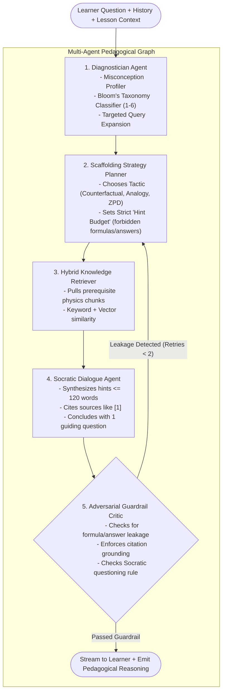

# AnuJnana — Multi-Agent Socratic Learning Compass 🧠

[](https://www.typescriptlang.org/)
[](https://reactjs.org/)
[](https://vitejs.dev/)
[](https://tailwindcss.com/)
[](https://github.com/langchain-ai/langgraph)
[](https://supabase.com/)
[](https://vitest.dev/)

An adaptive, intelligent STEM learning platform for quantum physics education. Instead of spoon-feeding answers or derivations, **AnuJnana** pairs learners with a **5-stage Multi-Agent Socratic Pedagogical Graph** that diagnoses misconceptions, scaffolds understanding through guided questions, enforces strict anti-answer-leakage guardrails, and monitors engagement via real-time on-device computer vision.

---

## 🏛 Architecture

### Multi-Agent Pedagogical Graph



---

## ✨ Key Features

1. **Multi-Agent Socratic AI Tutor**:
   - **Active Misconception Profiling**: Detects underlying conceptual blocks (e.g. classical zero-velocity confusion vs quantum ground-state confinement).
   - **Anti-Leakage Guardrail**: Prevents formula disclosure when students demand direct solutions.
   - **Zone of Proximal Development (ZPD)**: Scaffolds hints aligned with Bloom's Taxonomy stages.
   - **Transparent Pedagogical Reasoning**: Streams internal pedagogical rationale to the UI in an expandable drawer.
   - **Hybrid RAG**: Fuses `pgvector` cosine similarity with BM25 keyword matching over verified curriculum passages.

2. **Real-Time On-Device Attention Tracker**:
   - Analyzes facial landmarks, gaze direction, and blink rates in real time (60fps) using in-browser Web Workers.
   - **Zero cloud transmission**: Camera frames never leave the user's browser.
   - Automatically recommends **Relax Mode** when fatigue or cognitive overload is detected.

3. **Interactive Physics Visualizers**:
   - Pluckable standing wave guitar string simulator.
   - Particle-in-a-box energy level ladder and wave function visualizers.
   - Real-time SVG-based quantum animation engines.

4. **Cognitive Retention Engine**:
   - Spaced-repetition revision schedules based on the Ebbinghaus forgetting curve.
   - Interactive Concept Map navigation graph (`/concepts`).
   - Append-only activity tracking driving verifiable learner stats, streaks, and certificates.

---

## 🛠 Tech Stack

- **Frontend**: React 18, TypeScript, Vite, Tailwind CSS, shadcn/ui, Lucide Icons, HTML5 Canvas API
- **AI & Agent Orchestration**: LangGraph, Multi-Agent StateGraph, Server-Sent Events (SSE) Streaming
- **Backend & Database**: Supabase (PostgreSQL, `pgvector`, Auth, Edge Functions with Deno/TypeScript), FastAPI, Python
- **Testing**: Vitest, React Testing Library, JSDOM (39 unit & integration tests)

---

## 🚀 Quickstart

### 1. Prerequisites
- Node.js (v18+) and npm

### 2. Install & Run Web App
```bash
# Clone the repository
git clone <repository-url>
cd aura-socratic-learning-compass-main

# Install dependencies
npm install

# Start development server
npm run dev
```
Open `http://localhost:5173` in your browser.

### 3. Run Automated Tests & Build
```bash
# Run unit & integration test suite
npm test -- --run

# Run production build
npm run build
```

---

## 🔬 Standalone Python LangGraph Service (`agent-graph/`)

For offline experimentation, evaluation benchmarks, or local LLM serving (Ollama/vLLM):

```bash
cd agent-graph

# Install Python requirements
pip install -r requirements.txt

# Run the automated Socratic evaluation benchmark
python evaluate.py

# Start the FastAPI microservice
python server.py
```

---

## 📄 License

This project is licensed under the MIT License.
