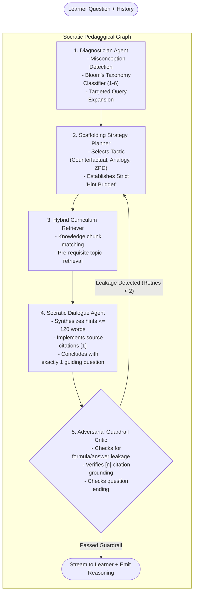

# AnuJnana Socratic Pedagogical Agent Graph 🧠

A production-grade Multi-Agent LLM pipeline built with **LangGraph** designed for adaptive STEM / Quantum Physics education.

Unlike single-prompt tutors that can be tricked into giving away homework answers or derivations, this system routes every inquiry through a 5-stage cognitive scaffolding graph.

---

## Architecture



---

## Key Features

1. **Active Misconception Profiling**: Detects underlying conceptual blocks (e.g., confusing classical rest with quantum ground state) before formulating a response.
2. **Strict Anti-Leakage Guardrail**: Prevents formula disclosure when students demand direct solutions (*"just give me the equation"*).
3. **Zone of Proximal Development (ZPD)**: Scaffolds hints at the learner's current Bloom's taxonomy stage.
4. **Transparent Pedagogical Reasoning**: Emits internal reasoning (`misconception`, `scaffolding_tactic`, `target_discovery`) to the frontend for UI inspection.

---

## Quickstart

### 1. Install Dependencies
```bash
cd agent-graph
pip install -r requirements.txt
```

### 2. Configure Environment (Optional)
To use live LLMs (OpenAI, Anthropic, or local Ollama), configure your `.env`:
```env
OPENAI_API_KEY=your_api_key_here
SOCRATIC_MODEL=gpt-4o-mini
```
*Note: If no API key is set, the graph operates in deterministic educational simulation mode for offline testing and benchmarking.*

### 3. Run Benchmark Evaluation
Test the agent against adversarial prompts and misconception cases:
```bash
python evaluate.py
```

### 4. Run the API Server
Start the FastAPI server:
```bash
python server.py
```
Endpoint available at `http://localhost:8000/api/socratic/chat`.

---

## Integration with the Frontend
The live web frontend (`SocraticTutorModal.tsx`) consumes these same stages natively via the Edge Function (`supabase/functions/rag-tutor`), rendering live **Pedagogical Reasoning** accordions above tutor replies!
